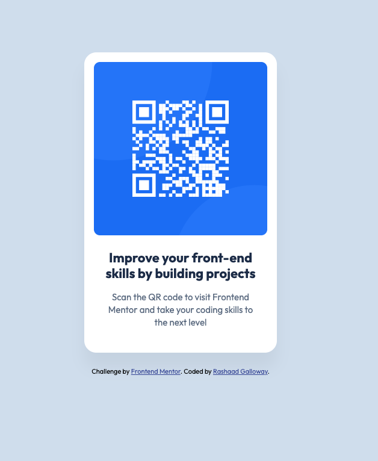

# Frontend Mentor - QR code component solution

This is a solution to the [QR code component challenge on Frontend Mentor](https://www.frontendmentor.io/challenges/qr-code-component-iux_sIO_H).

## Overview

### Screenshot

### Links

- Solution URL: [GitHub repo](https://github.com/mrg-repo/QR-Code-FrontendMentor)

### Built with

- Semantic HTML5 markup (`main`, `article`, `h1`, `p`, `footer`)
- CSS Flexbox
- Google Fonts (Outfit)

### What I learned

- **Flexbox centering:** `display: flex` with `justify-content` and `align-items` centers the card on any screen size.
- **Removing the image gap:** images are inline by default, which leaves a small gap underneath them. Making the card a flex container removed it.
- **Responsive without media queries:** the desktop and mobile designs are the same card, so `max-width` handles small screens without needing `@media`.
- **Measuring from design files:** I measured spacing from the 1440px design JPG (1 image pixel = 1 CSS pixel) while also using claude for firther sizing help.

### Continued development

-Continuing to increase the speed at which I can implement size and design changes
-Continuing to get better at media queries for layouts that change between mobile and desktop

### AI Collaboration

I used Claude to help me with the specifics of the design specs. This made it easier for me to manipulate the margins and padding properly.

## Author

- GitHub - [mrg-repo](https://github.com/mrg-repo)